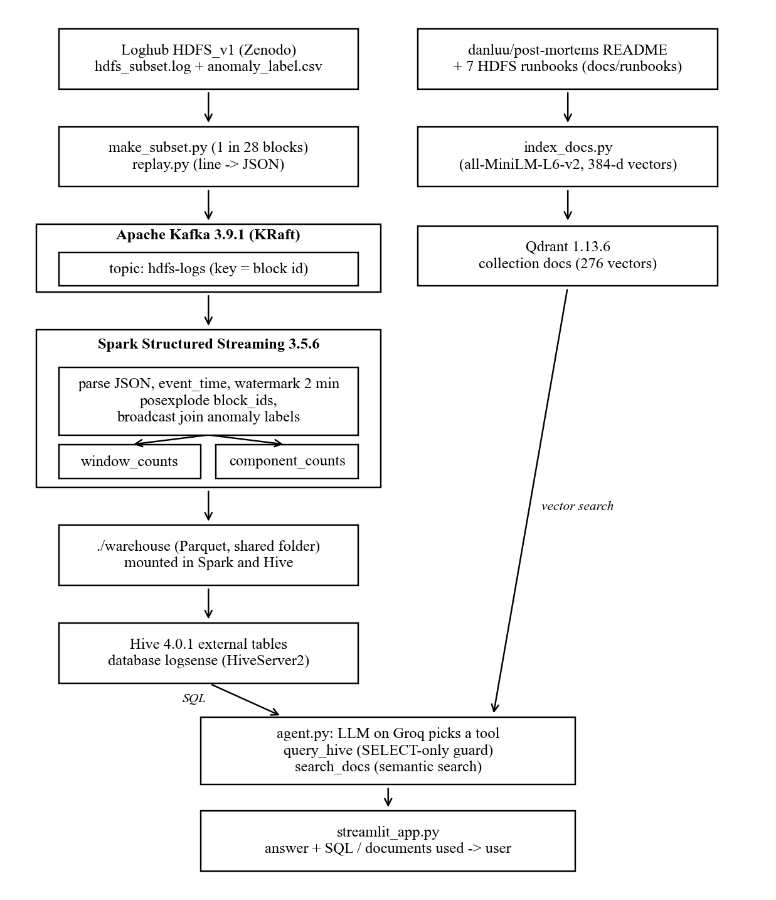

# LogSense

An assistant that answers plain-English questions about system failures in an HDFS cluster.

- **Number questions** ("How many anomalous blocks were there in the last hour?") are answered with SQL over Hive.
- **Meaning questions** ("What does 'Could not read from stream' mean and how do I fix it?") are answered with vector search over outage post-mortems and HDFS runbooks.
- An **LLM agent** reads each question and decides which tool to use, or both. The web page shows the answer along with the SQL or documents it used.

Built for CSE412 Big Data & Large-Scale Computing (Applied Project, Track D: Kafka → Spark Streaming → Hive).

## How it works

Real HDFS logs from the Loghub HDFS_v1 dataset (a 396,692-line subset with 20,434 blocks, 614 of them labelled anomalous) are replayed into an **Apache Kafka** topic. A **Spark Structured Streaming** job reads the topic, groups lines into 10-minute windows of the original 2008 log time, joins every block with its Normal/Anomaly label, and writes the counts as Parquet files. **Hive** reads those files through external tables, so the stream results can be queried with SQL.

Separately, 240 public outage post-mortems (from danluu/post-mortems) and 7 hand-written HDFS runbooks are embedded with sentence-transformers and stored in **Qdrant**. The agent (an LLM on Groq) has two tools: `query_hive`, which runs one SELECT statement after a safety check, and `search_docs`, which runs a semantic search. A **Streamlit** app puts it all behind one question box.

## Architecture

Spark and Hive never talk to each other directly. Spark writes Parquet files into `./warehouse`, both containers mount that folder at `/data/warehouse`, and the Hive tables point their `LOCATION` at it.

## Tech stack

| Part | Tool |
| --- | --- |
| Ingestion | Apache Kafka 3.9.1 (KRaft, no ZooKeeper) |
| Processing | Apache Spark 3.5.6 Structured Streaming (local mode) |
| SQL layer | Apache Hive 4.0.1 (external tables over Parquet) |
| Vector store | Qdrant 1.13.6 |
| Embeddings | sentence-transformers, all-MiniLM-L6-v2 (runs locally on CPU) |
| LLM | Groq API |
| Interface | Streamlit |

Everything runs in Docker on a laptop (WSL2, 11 GB of RAM for Linux).
